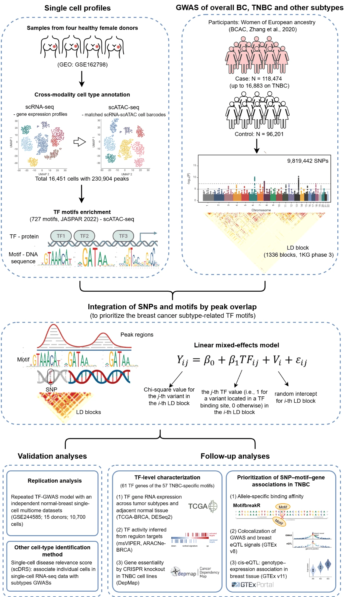

# TNBC TF-GWAS

Analysis code for:

> Liang Y, et al. **Integration of single-cell multi-omics data with GWAS reveals key
> transcriptional regulators underlying susceptibility to triple-negative breast cancer.**
> Manuscript under submission (2026). DOI: _to be added on publication_

## Overview

The TF-GWAS framework tests, for each of 727 JASPAR 2022 transcription-factor (TF) motifs,
whether GWAS variants in accessible chromatin carrying the motif show stronger association with
breast-cancer risk:

```
{subtype}_chisquare ~ motif_in_peak + (1 | LD block)        (lme4 / lmerTest)
```

fitted genome-wide for overall breast cancer and five intrinsic subtypes, using peaks from joint
scRNA-/scATAC-seq of normal breast tissue, and repeated in an independent single-cell cohort.

<p align="center">
  
</p>
<p align="center"><b>Figure 1.</b> Overview of the study workflow.</p>

## Data

No data are included in this repository. All inputs are public or available on application:

| Data | Source |
|---|---|
| Discovery scRNA-/scATAC-seq, 4 donors | GEO [GSE162798](https://www.ncbi.nlm.nih.gov/geo/query/acc.cgi?acc=GSE162798) |
| Replication 10x Multiome, pools 9/11/12, 15 donors | GEO [GSE244585](https://www.ncbi.nlm.nih.gov/geo/query/acc.cgi?acc=GSE244585); CELLxGENE collection `77446b76-1c2d-4a71-8e59-0efd4374d98e`; downloaded by `05_replication/01_download_geo_data.sh` |
| Breast-cancer subtype GWAS and overall-BC GWAS (Zhang et al. 2020) | Breast Cancer Association Consortium (BCAC), [GWAS summary associations](https://www.ccge.medschl.cam.ac.uk/breast-cancer-association-consortium-bcac/data-data-access/summary-results/gwas-summary-associations) |
| LD blocks (pyrho EUR, GRCh38) | [jmacdon/LDblocks_GRCh38](https://github.com/jmacdon/LDblocks_GRCh38) |
| GRCh37 → GRCh38 chain | UCSC `hg19ToHg38.over.chain.gz` |
| 1000 Genomes Phase 3 EUR panel | 1000 Genomes Project |
| 1000 Genomes EUR SNP reference VCF (rsIDs) | `1000G.EUR.QC.plink.simple.vcf` |
| GTEx v8 breast cis-eQTL summary statistics | eQTL Catalogue `QTD000211` |
| GTEx v11 breast expression and v9 WGS genotypes (Fig 5D–H) | dbGaP `phs000424` (controlled access) |
| TCGA-BRCA RNA-seq and PAM50 calls | Genomic Data Commons (Data Release 44.0), downloaded by `08_tcga_viper_depmap/01_download_tcga_brca.R` |
| CRISPR gene effects | DepMap Public 25Q3 |
| TF motifs | JASPAR 2022 (`JASPAR2022` Bioconductor package) |
| LD for locus plots | LDlink (`LDlinkR`) |

`reference/` holds small lookup tables used by the scripts (the 727 tested motif IDs, motif → TF
family assignments, promoter-SNP target genes), derived from JASPAR 2022 (CC BY 4.0).

## Citation

If you use this code, please cite the article above (see also `CITATION.cff`).

## License

MIT — see `LICENSE`.
